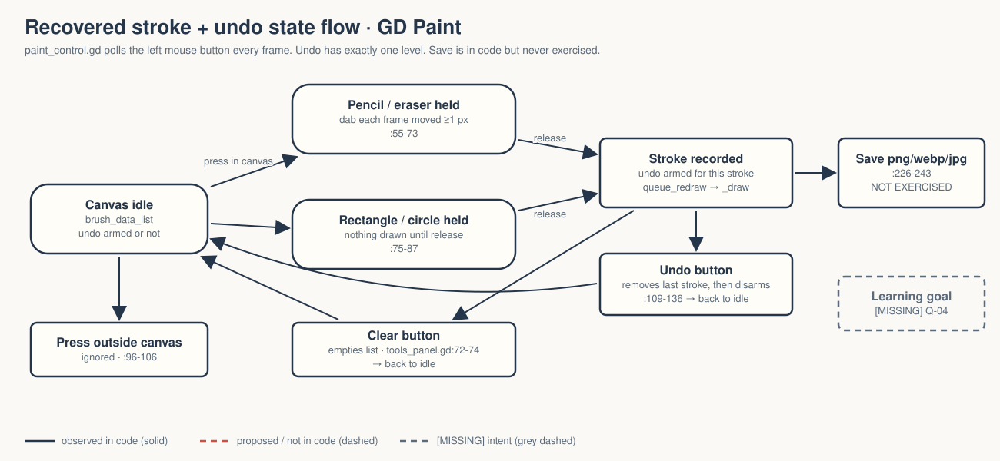
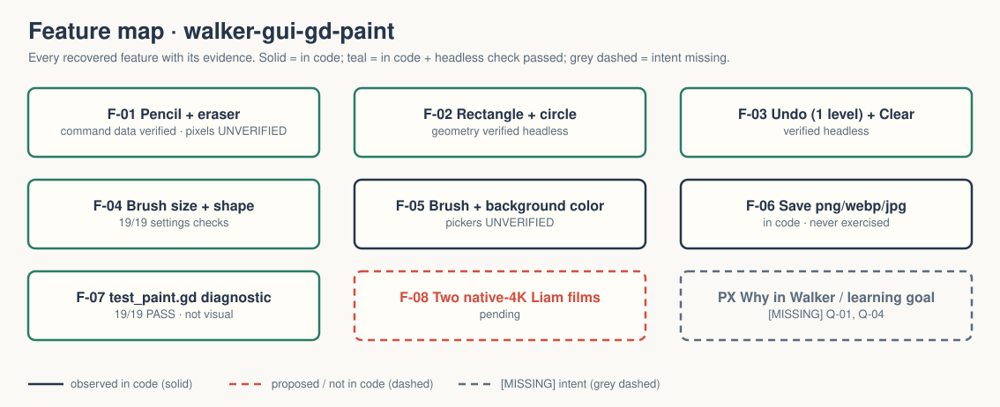

# walker-gui-gd-paint — Game Design Document (recovered)

| | |
|---|---|
| Version | 0.1.0-recovered |
| Date | 2026-09-27 |
| Author | Zelda (agent, silent), for Nik Bear Brown |
| Mode | recovered — `/gdd reverse --path godot silent` |
| Revision | 1 |
| Gates | gate — unsigned at time of writing · vision ○ · systems ○ · world ○ · scope ○ |
| Source | Godot demo `gui/gd_paint`, commit `a3b5c113112f77291d5f3d1360f33a882fdc52f7`; Walker change is the project title only |
| What this is | **A tech demo, not a game.** A small paint program (pencil, eraser, rectangle, circle, undo, clear, save). |

Provenance tags: `[OBSERVED path:line]` the code or a project file does this · `[INFERRED]` the code strongly implies this, evidence stated · `[MISSING]` nothing in the folder can tell us this; each one is an open question in `design/decisions.md`. Paths are relative to the project folder (the folder that contains `godot/`). This file is identical at `GDD.md` and `design/GDD.md`.

A recovered GDD describes what exists. It approves nothing, and a paint tool is not a game.

Evidence image: `godot/screenshots/gdpaint.png` (1275×717) is the **upstream** screenshot retained with the copy `[OBSERVED README.md:4-5]`. It is not a Walker capture; pixel output is unverified `[OBSERVED README.md:7-10]`.

## 1. Vision summary

**Logline (recovered).** "GD Paint is a simple image editor made using Godot and GDScript. It supports different types of 'brushes': a basic pen/pencil and eraser, as well as a rectangle and a circle brush." `[OBSERVED godot/project.godot:14-16]`

**What it teaches** `[INFERRED from structure]`: immediate-mode drawing in Godot. Every stroke is stored as a list of small dictionaries and the whole list is redrawn in `_draw()` `[OBSERVED godot/paint_control.gd:22,139-188,191-223]`; saving grabs the rendered viewport and crops it `[OBSERVED :226-243]`.

**User fantasy / goal.** A blank canvas and tools; the user decides what to draw. There is no objective, score, or end `[OBSERVED — no state beyond the brush list]`.

**Why it is in Walker, and for whom.** `[MISSING → Q-01, Q-02]` The folder records verification and two pending films `[OBSERVED README.md:7-10]`; it does not say why a paint demo belongs in Walker.

## 2. Design pillars

`[MISSING → Q-03]` None declared. The code implies `[INFERRED]`:
- **Commands, not pixels.** The canvas is a replayable list of brush records, never a bitmap until save (`paint_control.gd:22`).
- **Simple over correct.** The eraser paints the background color instead of erasing; the source says so: "a really cheap way of erasing that isn't really erasing" `[OBSERVED godot/paint_control.gd:206-207]`.

## 3. Core loop

- **Second to second.** Hold the left mouse button inside the white canvas and move: pencil/eraser add a round or square dab every frame the mouse has moved at least 1 px `[OBSERVED godot/paint_control.gd:55-73]`. Rectangle and circle tools add one shape on release, from press point to release point `[OBSERVED :75-87,153-184]`.
- **Minute to minute.** Pick a tool, brush shape (box/circle), brush size (scroll bar, min 2, starts 32), brush color and background color; Undo the last stroke; Clear the canvas `[OBSERVED godot/tools_panel.gd:13-33,41-103; godot/paint_root.tscn:204-212]`.
- **Session.** Save the canvas as PNG, WebP or JPEG through a file dialog `[OBSERVED godot/paint_control.gd:236-243; godot/paint_root.tscn:334-339]`. Save/export was deliberately **not** exercised; it needs a real renderer frame `[OBSERVED FRICTIONAL.md]`.

A creative-tool loop, not a game loop: there is no feedback tied to an objective. `[INFERRED]`

## 4. Player Experience Goals

`[MISSING → Q-04]` None declared. Nothing in the folder states what a user should feel or learn. The tool's limits suggest it was never meant as a real editor `[INFERRED — single-level undo, no stroke interpolation, fake eraser, see §5]`.

## 5. Mechanics

Numbers are observed defaults, not approved tuning.

- **M-01 Pencil** — dab per frame at mouse position when moved ≥ 1 px; shape follows brush shape; size is diameter `[OBSERVED godot/paint_control.gd:64-73,194-204]`. Dabs are not joined, so fast strokes can leave gaps `[INFERRED — no interpolation between `last_mouse_pos` and `mouse_pos`; not verified visually]`.
- **M-02 Eraser** — same as pencil but drawn in the background color `[OBSERVED :205-215]`. Changing the background color later recolors every past eraser dab and the canvas together `[INFERRED from godot/tools_panel.gd:92-97 + paint_control.gd:213,215]`.
- **M-03 Rectangle** — press-to-release box, corners normalized so any drag direction works `[OBSERVED godot/paint_control.gd:153-175,216-220]`.
- **M-04 Circle** — center is the midpoint of press and release; radius is the vertical half-distance only `[OBSERVED :178-184]`. A wide, flat drag makes a small circle `[INFERRED from line 184]`.
- **M-05 Start inside or not at all** — a stroke that starts outside the canvas does nothing even if it moves in, so picking a color does not paint `[OBSERVED :96-106 comment; test "outside-start drag ignored" in paint-modes-20260927.log]`.
- **M-06 Undo** — one level only: a pencil/eraser stroke removes every dab added since the press; a shape removes the last record; after one undo, Undo does nothing until a new stroke `[OBSERVED :109-136]`.
- **M-07 Clear** — empties the brush list; Undo after Clear stays empty `[OBSERVED godot/tools_panel.gd:72-74; paint-modes-20260927.log]`.
- **M-08 Brush settings** — size scroll bar (min 2, step 1, value 32) updates `Brush size: Npx`; box/circle shape buttons; settings dim to 50% in shape tools, where they do not apply `[OBSERVED godot/paint_root.tscn:204-212; godot/tools_panel.gd:48-60,100-103]`.
- **M-09 Colors** — brush ColorPickerButton; background ColorPickerButton (starts white) also modulates the canvas panel `[OBSERVED godot/tools_panel.gd:87-97; godot/paint_root.tscn:282-288]`. Picker interaction unverified `[OBSERVED FRICTIONAL.md]`.
- **M-10 Save** — `await RenderingServer.frame_post_draw`, crop viewport image to the canvas rect, save by extension; JPEG at quality 1.0 `[OBSERVED godot/paint_control.gd:226-243]`. Unverified.
- **M-11 Stats** — "Brush objects: N" updated every physics frame `[OBSERVED godot/tools_panel.gd:36-38]`.

## 6. Systems

- **S-01 Scene.** `PaintRoot` Control → `DrawingAreaBG` (white Panel, anchored from 34.2% of width), `PaintControl` (full-screen Control with `paint_control.gd`), `ToolsPanel` (350×600 dark Panel with `tools_panel.gd`), `SaveFileDialog` `[OBSERVED godot/paint_root.tscn:29-66,334]`.
- **S-02 Brush store.** `brush_data_list: Array[Dictionary]`, keys `brush_type, brush_pos, brush_shape, brush_size, brush_color` plus `brush_shape_rect_pos_BR` or `brush_shape_circle_radius` `[OBSERVED godot/paint_control.gd:22,141-184]`.
- **S-03 Input.** No `[input]` section; `paint_control.gd` polls `Input.is_mouse_button_pressed(MOUSE_BUTTON_LEFT)` and viewport mouse position in `_process` `[OBSERVED :48-55]`; the tools use button `pressed`, `color_changed`, `value_changed`, `file_selected` signals connected in code `[OBSERVED godot/tools_panel.gd:15-33]`.
- **S-04 Save.** FileDialog with filesystem access (`access = 2`), hidden files shown, filters PNG/WebP/JPEG `[OBSERVED godot/paint_root.tscn:334-339]`. No load; no persistence of the brush list.
- **S-05 Display.** Stretch mode `viewport`, aspect `keep_height`, integer scale `[OBSERVED godot/project.godot:29-31]`.

## 7. Progression

None `[OBSERVED]`.

## 8. World

None. Dark tool panel, white canvas `[OBSERVED godot/paint_root.tscn:7-11]`. No lore.

## 9. Narrative

None. Reasoned N/A.

## 10. Characters

None.

## 11. Features and priority

| ID | Feature | Tag | PX | Evidence | Status |
|---|---|---|---|---|---|
| F-01 | Pencil + eraser strokes (M-01, M-02, M-05) | untagged | none declared | paint_control.gd:48-93 | command data verified headless; **pixels unverified** |
| F-02 | Rectangle + circle shapes (M-03, M-04) | untagged | none | :139-188 | geometry verified headless |
| F-03 | Single-level Undo, Clear (M-06, M-07) | untagged | none | :109-136; tools_panel.gd:72-78 | verified headless |
| F-04 | Brush settings: size, shape (M-08) | untagged | none | tools_panel.gd:41-103 | verified headless (19/19) |
| F-05 | Brush + background color (M-09) | untagged | none | tools_panel.gd:87-97 | **picker unverified** |
| F-06 | Save PNG/WebP/JPEG (M-10) | untagged | none | paint_control.gd:226-243 | **not exercised** |
| F-07 | Headless diagnostic `test_paint.gd` | Walker tooling | — | paint-settings-label-20260927.log 19/19 | passes; not visual |
| F-08 | Two native-4K Liam films | Walker production | — | README.md:10 | **pending** |

**CORE percentage:** not computable; nothing is tagged and no MVP is defined `[MISSING → Q-05]`.

## 12. Out of scope

By absence, not decision `[INFERRED]`: loading images, layers, multi-level undo/redo, true (transparent) erasing, stroke smoothing, zoom/pan, pressure, keyboard shortcuts. The upstream code notes the eraser and single-undo simplifications itself `[OBSERVED godot/paint_control.gd:121-122,206-207]`.

## 13. Technical

Godot 4.7.2 stable `[OBSERVED FRICTIONAL.md; runtime-20260927.log]`, features "4.7", GL Compatibility `[OBSERVED godot/project.godot:19,35-36]`; `redundant_await` warning disabled (the save coroutine) `[OBSERVED :25]`. Assets: `paint_tools.png` 32×32 atlas cut into four 16×16 tool icons `[OBSERVED godot/paint_root.tscn:13-27]`, SHA-256 recorded in FRICTIONAL.md; its authorship is not independently established; the root MIT license and original attribution are retained `[OBSERVED FRICTIONAL.md]` → `[MISSING → Q-07]`. Performance: every frame with a change redraws the full list, so cost grows with brush count `[INFERRED from godot/paint_control.gd:191-223]`; no measurement exists. Differs from upstream only by the title line and `test_paint.gd(.uid)` `[OBSERVED — directory diff 2026-09-27]`.

## 14. Risks

| ID | Risk | Evidence | Mitigation |
|---|---|---|---|
| R-01 | Headless command-list checks read as "drawing verified" | README.md:7-9 | always say "drawing-command state tests, not pixels" |
| R-02 | Save dialog opens the whole filesystem with hidden files during a capture | paint_root.tscn:337-339 | decide Q-06 before filming Save |
| R-03 | Film demonstrates gaps in fast strokes or the circle radius rule as if they were bugs Walker introduced | §5 M-01, M-04 | name them as upstream behavior; Q-05 |
| R-04 | Tool atlas redistributed without established authorship | FRICTIONAL.md | Q-07 before any public release |
| R-05 | No stated purpose | §1 | Q-01 |

## 15. Open questions

Kept in `design/decisions.md`: Q-01 purpose in Walker · Q-02 audience · Q-03 pillars / upstream-faithful · Q-04 PX goal · Q-05 scope beyond upstream (undo depth, interpolation, true eraser) · Q-06 save/export verification and filesystem access in films · Q-07 `paint_tools.png` authorship · Q-08 film plan · Q-09 visual QA owner.

## 16. Tests

Existing (`godot/test_paint.gd`, real mouse events and focused-Enter GUI buttons) `[OBSERVED]`:
- paint-coordinates-20260927.log 7/7; paint-modes-20260927.log 14/14: T-01 starts empty · T-02 mouse stroke adds data · T-03 GUI Undo removes stroke · T-04 rectangle selected · T-05 one rectangle on release, geometry 50×40 · T-06 Clear empties · T-07 Undo after Clear stays empty · T-08 circle record and geometry · T-09 Undo circle · T-10 eraser command recorded · T-11 outside-start drag ignored.
- paint-settings-label-20260927.log 19/19: adds T-12 box brush selected · T-13 mouse slider raises size (32→38) · T-14 size label numeric content · T-15 stroke stores shape and size · T-16 circle brush restored.
- Earlier failing logs kept as history: paint-input and paint-diagnostic (2 failures; harness omitted `global_position`), paint-settings and paint-settings-mouse (1 failure each; keyboard focus on HScrollBar, then label format `38.0px`) `[OBSERVED FRICTIONAL.md]`.

Proposed (dashed in the deck, not written): H-01 pixel check of each tool against the upstream screenshot; H-02 save PNG/WebP/JPEG to a scratch folder and open them; H-03 fast diagonal pencil stroke, look for gaps.

## Zelda's read — 7 Failure Mode audit

| Mode | Rating | Evidence |
|---|---|---|
| Ghost Center | PRESENT (expected) | §1 purpose `[MISSING]` |
| Mechanic Mirage | PRESENT (expected) | the logline is a feature list |
| Implementation Void | PARTIAL | edge behaviors (circle radius, dab gaps, eraser recoloring) exist in code but nowhere in design text |
| Priority Inflation | N/A | no tags |
| Novelist's Trap | ABSENT | no lore |
| Completeness Fallacy | PARTIAL | save/export and filesystem access are live paths nobody has decided about |
| Stagnant Artifact | ABSENT from now | CHANGELOG.md started |

What the structure suggests the vision was `[INFERRED]`: a readable example of storing drawing commands and replaying them in `_draw()`, with just enough tools to feel like an app. It is honest about its shortcuts in its own comments.

## Zelda's notes (silent mode; what I would have said out loud)

1. This is a tool, not a game. Its "experience" is the user's own drawing. If Walker wants a PX goal, it will be a learning goal, and that is Q-04.
2. The three quirks (dab gaps, vertical-only circle radius, eraser that repaints) are upstream design choices. Do not "fix" them silently; if Walker changes them, log it.
3. Save is the most dangerous button here for a recording: a filesystem-wide dialog with hidden files showing. Q-06 first if a film shows it.
4. First fix: answer Q-01.
